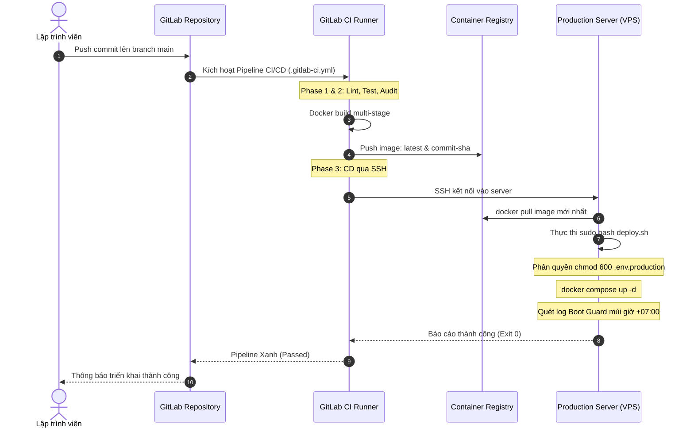

# TÀI LIỆU BÀN GIAO KỸ THUẬT: ĐỒNG BỘ GIT ĐA NỀN TẢNG & KẾ HOẠCH CI/CD
## HỆ THỐNG BOOKINGCARE BACKEND (POSTGRESQL 16 / NODE.JS)

* **Phiên bản:** 1.0 — Production Ready
* **Ngày cập nhật:** 27/10/2026
* **Đối tượng tiếp nhận:** Thành viên mới (New Developer / DevOps Engineer / Người kế thừa dự án)
* **Phạm vi tài liệu:** Cơ chế đồng bộ Dual-Remote (GitHub & GitLab), Quy trình làm việc hàng ngày, Kế hoạch & Kiến trúc CI/CD 4 Phase, Sổ tay vận hành (Runbook).

---

## MỤC LỤC
1. [Tổng quan Kiến trúc & Hạ tầng Kỹ thuật](#1-tổng-quan-kiến-trúc--hạ-tầng-kỹ-thuật)
2. [Cơ chế Đồng bộ Git Đa Nền tảng (Dual-Remote Git)](#2-cơ-chế-đồng-bộ-git-đa-nền-tảng-dual-remote-git)
   - 2.1. Mục tiêu và Nguyên lý hoạt động
   - 2.2. Chi tiết cấu hình Dual Push Remote
   - 2.3. Lịch sử các lỗi thực tế đã xử lý và giải pháp
3. [Hướng dẫn Onboarding từng bước cho Người mới](#3-hướng-dẫn-onboarding-từng-bước-cho-người-mới)
   - 3.1. Clone và thiết lập ban đầu
   - 3.2. Cấu hình Dual-Remote trên máy làm việc mới
   - 3.3. Quy trình làm việc chuẩn hàng ngày (Daily Workflow)
4. [Kế hoạch & Đặc tả Kỹ thuật CI/CD theo 4 Phase](#4-kế-hoạch--đặc-tả-kỹ-thuật-cicd-theo-4-phase)
   - Phase 1: Chuẩn hóa Code Quality & Quản lý Secrets
   - Phase 2: Pipeline Tích hợp liên tục (CI)
   - Phase 3: Pipeline Triển khai liên tục (CD) kết hợp `deploy.sh`
   - Phase 4: DevSecOps, Tự động Rollback & Giám sát
5. [Từ điển Biến Môi trường CI/CD (Variables Dictionary)](#5-từ-điển-biến-môi-trường-cicd-variables-dictionary)
6. [Sổ tay Vận hành & Xử lý Sự cố (Runbook & Troubleshooting)](#6-sổ-tay-vận-hành--xử-lý-sự-cố-runbook--troubleshooting)

---

## 1. TỔNG QUAN KIẾN TRÚC & HẠ TẦNG KỸ THUẬT

Hệ thống BookingCare Backend được thiết kế theo tiêu chuẩn công nghiệp với các trụ cột:
* **Runtime:** Node.js 18 LTS / Express 5.
* **Cơ sở dữ liệu:** PostgreSQL 16 Alpine (đã chuyển đổi từ MySQL 8.0), quản lý qua Sequelize ORM.
* **Bộ nhớ đệm (Caching):** Redis Alpine độc lập trong mạng nội bộ.
* **Mạng cô lập (3-Tier Network Isolation):**
  * `frontend-net`: Nginx Gateway tiếp nhận người dùng bên ngoài.
  * `backend-net`: Mạng riêng biệt chỉ backend, redis và postgresql giao tiếp với nhau (nghiêm cấm public port CSDL ra ngoài).
* **Chốt chặn vật lý:** Script `deploy.sh` bọc thép phân quyền `chmod 600` cho `.env.production` và xác minh múi giờ chuẩn `+07:00` (Asia/Ho_Chi_Minh).

---

## 2. CƠ CHẾ ĐỒNG BỘ GIT ĐA NỀN TẢNG (DUAL-REMOTE GIT)

### 2.1. Mục tiêu và Nguyên lý hoạt động
Dự án được duy trì đồng thời trên 2 nền tảng:
1. **GitHub cá nhân (`duchai1703`):** Lưu trữ mã nguồn mở, phục vụ hồ sơ năng lực (Portfolio/CV).
2. **GitLab nội bộ (`gitlab.s2.ttpprojects.com`):** Báo cáo tiến độ đào tạo, nộp bài, chạy CI/CD và quản lý Merge Request.

Thay vì phải chạy 2 lệnh push thủ công, Git Local được cấu hình **Dual-Push URL** trên cùng remote `origin`. Khi gõ lệnh `git push` hoặc bấm nút Sync trên VS Code, Git sẽ tự động tuần tự đẩy commit lên cả 2 server.

```
       +------------------------------------+
       |   Máy phát triển (Local Git)       |
       |   Remote: origin (Dual-Push URLs)  |
       +-----------------+------------------+
                         | (1 lần git push)
            +------------+------------+
            |                         |
            v                         v
+-----------------------+ +-----------------------+
|   GitHub Repository   | |   GitLab Repository   |
|   (duchai1703/...)    | | (training/booking-care)|
+-----------------------+ +-----------------------+
```

### 2.2. Chi tiết cấu hình Dual Push Remote
Tại thư mục gốc của repository, cấu hình được thiết lập như sau:

```bash
# Kiểm tra remote hiện tại
git remote -v

# Cấu hình Fetch trỏ về GitHub (mặc định để kéo code an toàn)
git remote set-url origin https://github.com/duchai1703/bookingcare-backend.git

# Gán URL Push thứ nhất: GitHub
git remote set-url --push origin https://github.com/duchai1703/bookingcare-backend.git

# Thêm URL Push thứ hai: GitLab
git remote set-url --add --push origin https://gitlab.s2.ttpprojects.com/training/booking-care/bookingcare-backend.git
```

Khi chạy `git remote -v`, kết quả chuẩn xác là:
```text
origin  https://github.com/duchai1703/bookingcare-backend.git (fetch)
origin  https://github.com/duchai1703/bookingcare-backend.git (push)
origin  https://gitlab.s2.ttpprojects.com/training/booking-care/bookingcare-backend.git (push)
```

### 2.3. Lịch sử các lỗi thực tế đã xử lý và giải pháp

Người mới cần nắm rõ 3 rào cản kỹ thuật đã được xử lý để không làm hỏng cấu hình:

| Rào cản kỹ thuật | Triệu chứng lỗi | Nguyên nhân gốc rễ | Giải pháp chuẩn đã thực hiện |
| :--- | :--- | :--- | :--- |
| **1. Authentication (Xác thực)** | `fatal: Authentication failed` hoặc `HTTP Basic: Access denied` | GitLab và GitHub dùng 2 tài khoản khác nhau. Khi kết nối qua HTTPS, Git chưa lưu token/mật khẩu GitLab. | Nhập Personal Access Token (PAT) hoặc thông tin đăng nhập của GitLab. Windows Credential Manager tự động lưu thông tin theo Domain riêng biệt (`github.com` vs `gitlab.s2.ttpprojects.com`), không bị xung đột. |
| **2. Unrelated Histories** | `! [rejected] main -> main (fetch first)` | Khi tạo dự án mới trên GitLab, GitLab tự tạo 1 commit khởi tạo (`README.md`). Local và GitHub không có commit này nên bị lệch lịch sử. | Thực hiện `git fetch gitlab` rồi dùng lệnh `git merge gitlab/main --allow-unrelated-histories` để hợp nhất commit `README.md` sạch sẽ mà không mất code. |
| **3. Protected Branch Hook** | `remote: GitLab: You are not allowed to force push code to a protected branch... (pre-receive hook declined)` | Nhánh `main` trên GitLab mặc định được bảo vệ (Protected Branch), pre-receive hook chặn mọi lệnh `git push --force`. | Sau khi đã merge commit ở bước 2, lịch sử đã liền mạch. Lệnh push trở thành **Fast-forward push**, hợp lệ và được GitLab chấp nhận ngay mà không cần quyền force push. |

---

## 3. HƯỚNG DẪN ONBOARDING TỪNG BƯỚC CHO NGƯỜI MỚI

Nếu bạn là thành viên mới tiếp nhận dự án trên một máy tính mới, hãy làm theo đúng thứ tự sau:

### Bước 1: Clone dự án về máy
```bash
git clone https://github.com/duchai1703/bookingcare-backend.git
cd bookingcare-backend
```

### Bước 2: Cài đặt thông tin tác giả commit (nếu cần phân biệt)
```bash
# Thiết lập riêng cho repo này (không ảnh hưởng toàn cầu)
git config user.name "Họ và Tên Của Bạn"
git config user.email "email_cua_ban@example.com"
```

### Bước 3: Cấu hình Dual-Push lên GitLab
```bash
# Thêm đường dẫn push sang GitLab
git remote set-url --add --push origin https://gitlab.s2.ttpprojects.com/training/booking-care/bookingcare-backend.git

# Kiểm tra lại cấu hình
git remote -v
```

### Bước 4: Kiểm tra xác thực (Test Push)
Thực hiện một thay đổi nhỏ (hoặc chạy thử `git push`). Nếu máy hỏi đăng nhập GitLab:
* **Tài khoản:** Nhập username hoặc email của tài khoản GitLab nội bộ.
* **Mật khẩu:** Nhập mật khẩu tài khoản hoặc **Personal Access Token** (tạo tại `GitLab > User Settings > Access Tokens` với quyền `read_repository` và `write_repository`).

### Bước 5: Quy trình làm việc hàng ngày (Daily Workflow)
1. **Lấy code mới:**
   ```bash
   git pull origin main
   ```
2. **Commit và đẩy code:**
   ```bash
   git add .
   git commit -m "feat: mô tả thay đổi tính năng"
   git push origin main
   ```
   *(Hoặc bấm nút **Sync Changes** trên giao diện Source Control của VS Code — Git sẽ tự động đẩy đồng bộ lên cả GitHub và GitLab).*

---

## 4. KẾ HOẠCH & ĐẶC TẢ KỸ THUẬT CI/CD THEO 4 PHASE

Kế hoạch này được thiết kế để tự động hóa hoàn toàn quy trình từ kiểm thử đến triển khai lên máy chủ Production.



### Chi tiết 4 Phase triển khai:

#### Phase 1: Chuẩn hóa Code Quality & Quản lý Secrets (Foundation)
* **Mục tiêu:** Đảm bảo code sạch, không chứa lỗ hổng nghiêm trọng và bảo mật 100% các bí mật hệ thống.
* **Tiêu chuẩn nghiệm thu:**
  * Toàn bộ mật khẩu DB, khóa JWT, API key của Gemini AI được lưu tại **GitLab CI/CD Variables** (chọn `Masked` và `Protected`).
  * Không bao giờ commit file `.env.production` vào Git.
  * Thêm lệnh kiểm tra lỗ hổng bảo mật: `npm audit --production --audit-level=high`.

#### Phase 2: Pipeline Tích hợp liên tục (CI Pipeline)
* **Mục tiêu:** Tự động hóa build và đóng gói Docker Image khi có code mới.
* **Cơ chế:**
  * Pipeline chạy trên image `docker:24.0.5-dind` (Docker in Docker).
  * Tận dụng Docker Cache để rút ngắn thời gian build.
  * Image sau khi build được tag theo 2 định dạng:
    * `$CI_REGISTRY_IMAGE:$CI_COMMIT_SHORT_SHA` (dùng để truy vết và rollback).
    * `$CI_REGISTRY_IMAGE:latest` (dùng để deploy bản mới nhất).

#### Phase 3: Pipeline Triển khai liên tục (CD Pipeline)
* **Mục tiêu:** Tự động đưa bản dựng mới vào vận hành không cần thao tác tay.
* **Tích hợp với `deploy.sh` có sẵn:**
  * Kết nối SSH bằng Private Key an toàn.
  * Gọi trực tiếp `deploy.sh` để thực thi 3 trụ cột:
    1. **Bảo mật file vật lý:** `chmod 600 .env.production` và `chown root:root`.
    2. **Khởi chạy container:** `docker compose --env-file .env.production up --build -d`.
    3. **Boot-Time Guard Verification:** Rà soát log tìm chữ ký xác thực múi giờ `+07:00` trong vòng 60 giây.

#### Phase 4: DevSecOps, Tự động Rollback & Giám sát (Observability)
* **Mục tiêu:** Độ tin cậy cao, tự phục hồi khi xảy ra sự cố.
* **Cơ chế Rollback:**
  * Nếu `deploy.sh` trả về mã lỗi khác 0 hoặc quá 60s không tìm thấy Boot Guard, job deploy sẽ thất bại.
  * Tự động chạy lệnh khôi phục image SHA trước đó: `docker compose up -d --no-build` với image cũ để hệ thống không bị gián đoạn.
* **Thông báo (Alerting):**
  * Tích hợp Telegram/Discord Webhook gửi trạng thái: Tên commit, tác giả, trạng thái Success/Failed.

---

## 5. TỪ ĐIỂN BIẾN MÔI TRƯỜNG CI/CD (VARIABLES DICTIONARY)

Các biến bắt buộc phải cấu hình tại **GitLab > Settings > CI/CD > Variables**:

| Tên biến | Loại | Protected | Masked | Mô tả mục đích |
| :--- | :--- | :---: | :---: | :--- |
| `SSH_PRIVATE_KEY` | File / Variable | Yes | No | Khóa bí mật SSH để kết nối đến Server Production. |
| `SERVER_IP` | Variable | Yes | No | Địa chỉ IP của máy chủ triển khai. |
| `SERVER_USER` | Variable | Yes | No | Tên người dùng có quyền sudo trên server (ví dụ: `ubuntu` hoặc `root`). |
| `PRODUCTION_ENV_BASE64` | Variable | Yes | No | Toàn bộ nội dung file `.env.production` đã mã hóa chuỗi Base64. |
| `CI_REGISTRY_USER` | Variable | No | No | Tài khoản để push/pull image vào GitLab Container Registry (có sẵn mặc định). |
| `CI_REGISTRY_PASSWORD` | Variable | Yes | Yes | Mật khẩu/token container registry (có sẵn mặc định `$CI_JOB_TOKEN`). |

---

## 6. SỔ TAY VẬN HÀNH & XỬ LÝ SỰ CỐ (RUNBOOK & TROUBLESHOOTING)

### Sự cố 1: Lỗi `Authentication failed` khi push code
* **Nguyên nhân:** Mật khẩu tài khoản GitLab thay đổi hoặc Personal Access Token hết hạn.
* **Khắc phục:**
  1. Trên Windows: Mở **Start Menu** $\rightarrow$ gõ **Credential Manager** $\rightarrow$ chọn **Windows Credentials**.
  2. Tìm mục `git:https://gitlab.s2.ttpprojects.com`.
  3. Bấm **Edit** và cập nhật mật khẩu mới hoặc Token mới.

### Sự cố 2: Lỗi lệch commit giữa 2 remote (GitLab ahead hoặc GitHub ahead)
* **Nguyên nhân:** Ai đó đã merge hoặc commit trực tiếp trên giao diện web của một bên mà bên kia chưa có.
* **Khắc phục:**
  ```bash
  # Kéo code mới nhất từ cả 2 remote về kiểm tra
  git fetch origin
  git fetch https://gitlab.s2.ttpprojects.com/training/booking-care/bookingcare-backend.git main:gitlab-temp

  # Hợp nhất commit lệch
  git merge gitlab-temp -m "chore: đồng bộ commit giữa 2 nền tảng"

  # Đẩy ngược lại lên cả 2 nơi
  git push origin main

  # Xóa nhánh tạm
  git branch -D gitlab-temp
  ```

### Sự cố 3: Container backend bị crash sau khi deploy
* **Nguyên nhân:** Thiếu biến môi trường hoặc sai mật khẩu kết nối cơ sở dữ liệu PostgreSQL.
* **Khắc phục trên server:**
  ```bash
  # Kiểm tra trạng thái các container
  docker compose ps

  # Xem log chi tiết của backend
  docker logs --tail 100 -f app-backend

  # Kiểm tra kết nối mạng nội bộ giữa backend và postgresql
  docker exec -it app-backend nc -zv db-postgres 5432
  ```

---
*Tài liệu được biên soạn và lưu trữ tại thư mục `bookingcare-backend/DOCS/` nhằm phục vụ công tác bàn giao, vận hành và chuẩn hóa quy trình DevOps của dự án.*
